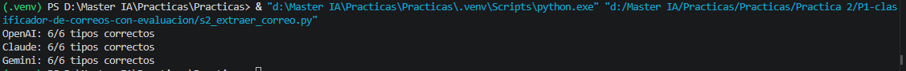
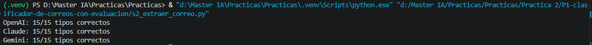
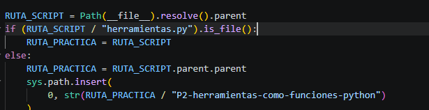
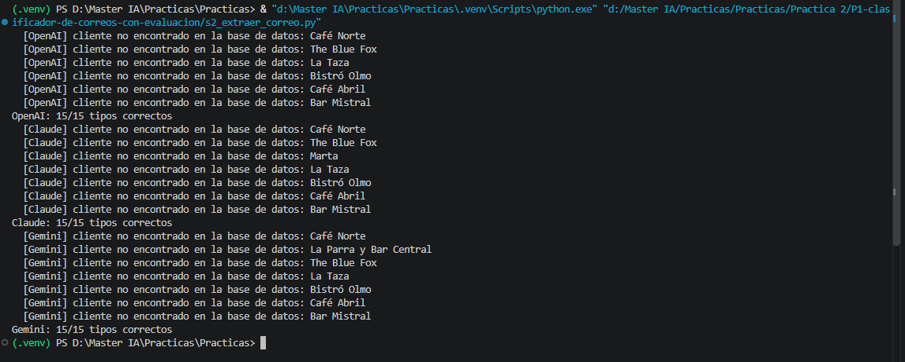

# Ejecuta el script y anota los aciertos de cada proveedor.

> Todos son 6/6 aciertos aunque gemini tarda tres veces mas

# Amplía `CASOS` hasta al menos 15, con casos difíciles: ironía, dos clientes en el mismo correo, un correo en inglés, un correo sin nombre de negocio.

> Increiblemente son 15/15 aciertos por lo que no hay fallos que ver

# Añade una validación de negocio: si hay cliente, comprueba con `buscar_cliente` que existe en la base de datos.

> Una herramienta es una funcion reutilizable que realiza una tarea concreta, como buscar un cliente en la base de datos. Se define una vez para poder llamarla cuando haga falta, en lugar de repetir su logica en distintos lugares. En un asistente con herramientas, el modelo puede solicitar su uso y el programa ejecuta la funcion y le devuelve el resultado

> Como se espera saca los clientes que no se encuentran en la base de datos, pero se han ido algunos saltando y otros metiendo, como por ejemplo OpenAI que segun los otros se salta Marta y La Parra y Bar Central

